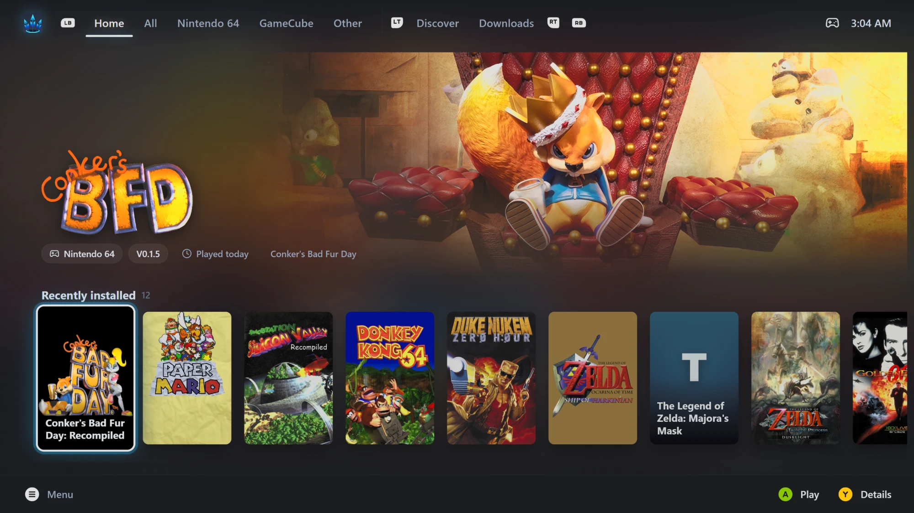
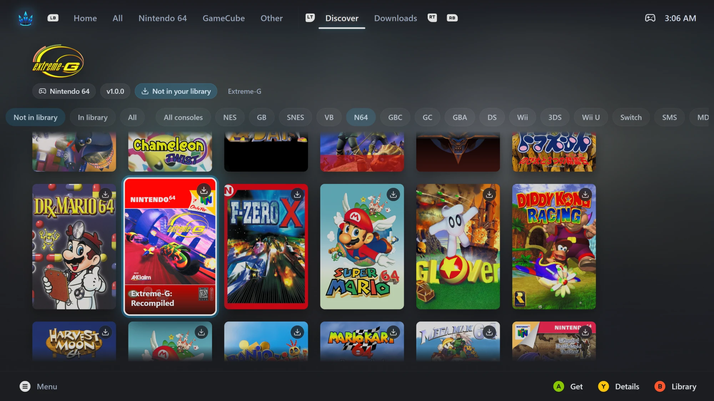

# Big Quiver Launcher





**Quiver Launcher with a Big Picture mode.** It turns [Quiver Launcher 4](https://github.com/tgeorgiadis/quiver-launcher)
into a fullscreen, controller-first launcher, like Steam's Big Picture or the Steam Deck. You can browse your library by
console, find new games, download them and play, all from the couch with an Xbox or PlayStation controller.

This is an unofficial fork. Everything Quiver Launcher 4 does still works in desktop mode: the catalog, the library, installs,
updates, playlists and accounts. Big Picture is an extra fullscreen mode on top. Both modes use the same library, and so will the
official Quiver Launcher 4 once it's released (see [Your library](#your-library)).

> **Built on Quiver Launcher by [Thomas Georgiadis](https://github.com/tgeorgiadis).** The launcher itself, its installs and
> updates, desktop mode, and the [quiverlauncher.com](https://quiverlauncher.com) catalog behind every game here are his work;
> this fork adds the Big Picture mode on top. If you enjoy it, please star and support the
> [original project](https://github.com/tgeorgiadis/quiver-launcher) ([Ko-fi](https://ko-fi.com/magicturt1e)).

> **Alpha.** It's built on Quiver Launcher 4, which hasn't been released yet: the current official release is Quiver Launcher
> 3.5. Tested on Windows 11 with Xbox and DualSense controllers.

## Features

- **Fullscreen, controller-first.** Big art tiles, smooth focus, and a hint bar at the bottom that shows the buttons for
  the controller in your hand (Xbox or PlayStation glyphs, switching on the fly).
- **A tab for each console.** Games are sorted into tabs (SNES, N64, GameCube, Genesis, PS1…) from the Quiver catalog, plus
  **Home** (recently played, updates available and recently installed), **All**, and **Apps & Tools** for emulators and utilities. Tabs come
  and go as you install and uninstall games.
- **Discover.** Browse the whole Quiver catalog by console, press A, and the game is added to your library and downloaded.
  You can stay and keep picking games while they download, or jump straight to the new game. Your choice, in Settings.
- **Downloads.** Watch progress and queue several games. Cancel a queued download by holding X for a second.
- **Updates your way.** When you press Play on a game with an update, Big Picture can ask (Update & play, Play this version,
  Skip this version), update first, or never update. You can also pick an older version from a game's details.
- **Game details.** Hero art, version, console and size. From here you can play, update, change version, move the game to
  another console tab, open its folder or uninstall it (hold to confirm).
- **Search with the controller.** An on-screen keyboard filters the library as you type and searches the catalog in Discover.
- **Gets out of the way while you play.** Quiver ignores the controller while a game is in front. When the game closes, Quiver
  comes back to the front, ready for input. This also works for games that start through a small launcher first.
- **One games folder with Quiver 3, if you want it.** Big Quiver can install games into your Quiver 3 games folder, move the
  ones it already installed there, and keep Quiver 3's list and version numbers up to date, so both launchers see the same
  games. See [Use the same games folder as Quiver 3](#use-the-same-games-folder-as-quiver-3).
- **Mouse, keyboard and controller all at once.** Use whichever is in your hand; every screen works with each of them.
- **Fits any screen.** Scales from 720p to 4K, with a size setting on top, and can open on the monitor of your choice
  (for example the TV).

## Install

### Download (Windows)

1. Download `Big.Quiver.Launcher_<version>_x64-setup.exe` from the [latest release](../../releases).
2. Run it. It installs for your Windows user only, with no admin rights needed, and adds **Big Quiver Launcher** to the Start menu.
3. Open it, then press the controller icon in the top bar to enter Big Picture.

Windows may warn you that the installer isn't from a known publisher. The builds aren't code-signed, so click **More info → Run anyway**.

Big Quiver Launcher installs under its own name, so you can keep Quiver Launcher 3 installed beside it, and the official
Quiver Launcher 4 once it's out.

### Build from source

You need Windows 10 or 11 (x64), [Node 22](https://nodejs.org), [pnpm](https://pnpm.io), [Rust](https://rustup.rs),
[CMake](https://cmake.org) (to build SDL3) and the Visual Studio C++ build tools.

```sh
git clone -b bigpicture https://github.com/OldRustyDusty/quiver-launcher-big-picture.git
cd quiver-launcher-big-picture
pnpm install
pnpm --filter @quiver/launcher tauri build --bundles nsis
```

The installer is written to `apps/launcher/src-tauri/target/release/bundle/nsis/`.

Linux builds should work, because the SDL3 reader builds there too, but they haven't been tested yet.

## Opening Big Picture

There are four ways in:

- The **controller icon** in the top bar of desktop mode.
- **Turning on a controller** while Quiver is open: a note offers Big Picture, and A opens it.
- **Settings → Start in Big Picture**, so Quiver always opens straight into it.
- The **`--bigpicture`** command-line flag. For example, a desktop or Steam shortcut to
  `"Big Quiver Launcher.exe" --bigpicture`.

To go back, open Settings (Menu / Options) and choose **Switch to desktop mode**. Signing in and account settings are there.

## Controls

| Controller | Keyboard | What it does |
|---|---|---|
| D-pad / left stick | Arrow keys | Move. Left and Right run through a grid in reading order, and wrap round at the ends |
| A / ✕ | Enter | Play, Get, or confirm |
| B / ○ | Esc / Backspace | Back, cancel, or clear a search |
| X / □ | X | Update the game; on a queued download, hold to cancel |
| Y / △ | Y | Game details |
| LB / RB (L1 / R1) | Q / E, or Shift+Tab / Tab | Previous / next tab. In Discover, the first press jumps to the console row |
| LT / RT (L2 / R2) | Page Up / Page Down | Jump between your library, Discover and Downloads |
| View / Create | / | Search |
| Menu / Options | F10 | Settings |

The mouse works everywhere too: pointing at a tile focuses it, a click does what A does, and a right click opens its
details. Destructive actions need a hold (Uninstall 1.5 s, Cancel 1 s), with a button or the mouse, and show a fill while you hold.

The Xbox / PS button is never used, so Steam and Windows keep it.

## Settings

Open Settings with Menu / Options, or F10.

| Setting | Choices |
|---|---|
| Updates when playing | Ask · Don't update · Update first |
| After getting a game | Stay in Discover (the game shows ✓ Installed there) · Go to it |
| Use the same games folder as Quiver 3 | On · Off (shown when Quiver 3 is on this computer; On asks first, and shows what it will do) |
| Start in Big Picture | On · Off |
| Offer Big Picture when a controller connects | On · Off |
| Home tab | On · Off |
| Console tab order | Maker, then year · Most games first · A–Z |
| All tab order | A–Z · Recently played |
| Size | 75 % to 150 % |
| Reduce motion | On · Off |
| Screen | Which monitor Big Picture uses |
| Unassigned games | Give games under *Other* their console |
| Switch to desktop mode | |

## Your library

**Big Quiver Launcher uses the same data folder as Quiver Launcher 4**
(`%APPDATA%\com.quiverlauncher.app` on Windows). That's deliberate, for when the official Quiver Launcher 4 is released:

- Your library, installed games and settings will appear in both apps.
- You'll be able to go back to the official app at any time, for example when it updates before this fork does, with your
  games all still there.
- Big Picture's own settings (console overrides, skipped versions, play counts) live in a separate file,
  `bigpicture.json`, which the official app ignores. Big Quiver never changes the format of the official app's files.

**Run one at a time.** If both apps are open together, each saves its own copy of the library over the other's.

### Coming from Quiver Launcher 3

Quiver Launcher 4 is a rewrite with its own data folder, so on its own it would start with an empty library. To avoid that, the
app offers to bring your Quiver 3 library over:

- **Nothing is downloaded again.** Installed games stay where they are, and Quiver 4 simply points at their folders, versions
  included.
- **Games are matched to the Quiver catalog** by their GitHub or GitLab repository, so they get catalog art, consoles and updates.
  Apps that aren't in the catalog come over as custom apps. Any that can't be matched are listed for you.
- **The import only reads Quiver 3**, so Quiver 3 keeps working. The games themselves are shared, though: updating or
  uninstalling an imported game in Big Quiver changes the same folder Quiver 3 uses.

The import itself is upstream Quiver's. The fork adds two things:

- **It finds Quiver 3 wherever you put it.** Upstream looks only in the default folders, so a portable or moved Quiver 3 (for
  example `E:\QuiverLauncher`) was never offered. Big Quiver also reads the folder from Quiver 3's own update log.
- **You can import with the controller.** When your library is empty, Big Picture's Home shows the offer, and A imports.

### Use the same games folder as Quiver 3

On its own, Quiver 4 installs new games into its own folder (`%APPDATA%\com.quiverlauncher.app\apps`, on your C: drive).
Quiver 3 doesn't know about those games, and it keeps showing old version numbers for games updated in Quiver 4. Turn this on to
keep everything in one place instead:

- **New games install into your Quiver 3 games folder** (for example `E:\QuiverLauncher\Apps`), and show up in Quiver 3 too.
- **Games Big Quiver already installed in its own folder are moved there.** Each one is copied and checked first, and only then
  does the old copy go to the Recycle Bin, so nothing is lost if something goes wrong part-way. A game that's running is left
  until next time.
- **Games you put in custom folders in Quiver 3 stay exactly where they are.**
- **A game installed by both launchers** keeps its newer copy, and the other goes to the Recycle Bin.
- **Games only Quiver 3 has** are added to your library where they are, nothing downloaded: catalog games, apps from a
  GitHub or GitLab repository, and Quiver 3's manual apps (folders you fill). This happens when you turn it on, and again each
  time Big Quiver starts, so games you add in Quiver 3 later show up too, with a short note.
- **Folders you fill** (Add an app → *A folder you fill yourself*) are made in your Quiver 3 games folder, and listed in
  Quiver 3 as manual apps. Ones you made before are moved there.
- **Updates and uninstalls** in Big Quiver show up in Quiver 3 too, with the right version numbers.
- **Games the official Quiver Launcher 4 installs** (once it's out) land in its own folder, because it doesn't know this setting.
  Big Quiver moves them over the next time it starts.

**How you're asked:** right after you import your Quiver 3 library, or (if you imported earlier) once on the first start with
this feature, with *Yes*, *Not now* and *Don't ask again*. It's recommended: both launchers then share the same game files and
folders, so each game is installed once, and its updates and saves work in both. You can also turn it on or off any time in Big Picture's Settings.
Before changing anything, it shows what it's going to do.

**Safe for Quiver 3's library:** Big Quiver writes Quiver 3's list (`apps.json`) only while Quiver 3 is closed. If Quiver 3
is open, it asks you to close it, or keeps the change until you do. It takes the same lock Quiver 3 uses, and saves a backup
in Quiver 3's own `Backups\apps` folder before every change. Turning the setting off asks first, and doesn't undo anything:
games already in Quiver 3's folder stay there, and new games go to Big Quiver's own folder again. That first backup restores
Quiver 3's list exactly as it was, if you ever need it.

**Adding your own games:** Big Quiver's Add an app offers *From GitHub or GitLab* and *A folder you fill yourself*, the same
two ways Quiver 3 has. Quiver 4's third option, *A program on this computer* (start an `.exe` from wherever it is), is hidden
in Big Quiver for now, because Quiver 3 has nothing like it. Programs added that way before still work.

**Shortcuts:** desktop shortcuts to moved games are made again automatically. Steam shortcuts to them stop working; add those
games to Steam again from their page in desktop mode.

## How it works

Big Picture is a fullscreen React layer inside the same Tauri window as desktop mode. Because both modes share one app state,
an install started in one shows up in the other at once.

- **Controllers** are read by [SDL3](https://libsdl.org), built from source into the app and running on its own thread. It reads
  them even while the window isn't focused, and Big Picture decides whether to use each press: it only does when Quiver is in front
  and no game is. SDL3 also says which kind of controller it is, so the button glyphs match. Desktop mode keeps upstream's own
  controller support.
- **Consoles** come from the Quiver catalog (`basedOn.console`, then `consoles`). Emulators and tools go to Apps & Tools, and
  you can move any game yourself.
- **Game sessions:** when you press Play, the Rust core keeps an eye on the game's process. If the process exits within 10
  seconds, it was probably a launcher, so the core watches for any process running from the game's folder instead. When the game
  ends, Quiver brings itself back to the front.
- **Art** comes from the catalog's library art (capsule, header, hero and logo). Games without art get a generated tile.
- Installs, updates and uninstalls all go through upstream Quiver's own code. Big Picture only decides when to call it.
- **Sharing with Quiver 3:** with that setting on, a small hook in upstream's install code lets Big Quiver choose the folder
  for new installs. The Rust core reads Quiver 3's `apps.json` and each game's `version.txt`, moves games (copy, check, then
  Recycle Bin), and writes `apps.json` the way Quiver 3 does: under its lock, with a backup, atomically, keeping every field
  it doesn't know.

Fork code lives in `apps/launcher/src/bigpicture/` (TypeScript) and `apps/launcher/src-tauri/src/bigpicture/` (Rust).
Each change to an upstream file is small and listed in [`docs/bigpicture/FORK_CHANGES.md`](docs/bigpicture/FORK_CHANGES.md),
which keeps merging upstream updates easy. The design and its decisions are in [`docs/bigpicture/`](docs/bigpicture).

## Develop

```sh
pnpm install
pnpm dev          # run the app; the controller icon in the top bar opens Big Picture
pnpm typecheck && pnpm test
cargo test --manifest-path apps/launcher/src-tauri/Cargo.toml
```

[`docs/bigpicture/TESTING.md`](docs/bigpicture/TESTING.md) covers running on test data, a controller-input overlay
(`QUIVER_BP_DEBUG=1`), a browser preview with no Tauri, and the manual test checklist.

| Path            | What it is                                                                 |
| --------------- | -------------------------------------------------------------------------- |
| `apps/launcher` | The Tauri app: React UI in `src`, Rust core in `src-tauri`                  |
| `packages/api`  | Typed client for the catalog API (`https://api.quiverlauncher.com/api/v1`) |
| `packages/ui`   | Catalog components and styles shared with quiverlauncher.com               |
| `e2e`           | User journeys run against the real app with WebDriver and a mock catalog   |

`QUIVER_API` points the app at another catalog and `QUIVER_DATA` at another data folder. A `portable.txt` beside the
executable keeps everything in a `data` folder next to it.

## Usage data

Upstream Quiver Launcher can send anonymous usage data to PostHog, but only when it's built with Quiver's project token.
This fork's builds don't include that token, so **they send no usage data**.

## Credits

- **[Quiver Launcher](https://github.com/tgeorgiadis/quiver-launcher) by [Thomas Georgiadis](https://github.com/tgeorgiadis)**
  ([@tgeorgiadis](https://github.com/tgeorgiadis)): the launcher this fork is built on, which is everything that isn't Big
  Picture, and the [quiverlauncher.com](https://quiverlauncher.com) catalog. Thank you! This fork isn't affiliated with or
  endorsed by Quiver.
- Button glyphs: [Kenney Input Prompts](https://kenney.nl/assets/input-prompts) (CC0).
- Controller input: [SDL3](https://libsdl.org) (zlib). Game-process tracking: [sysinfo](https://crates.io/crates/sysinfo) (MIT).

See [`docs/bigpicture/THIRD_PARTY.md`](docs/bigpicture/THIRD_PARTY.md).

## License

MIT, like upstream Quiver Launcher. The original copyright notice in [`LICENSE`](LICENSE) is kept as it is.
